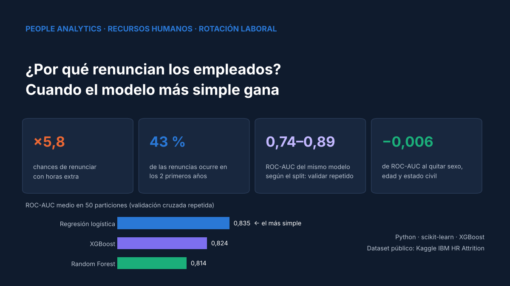
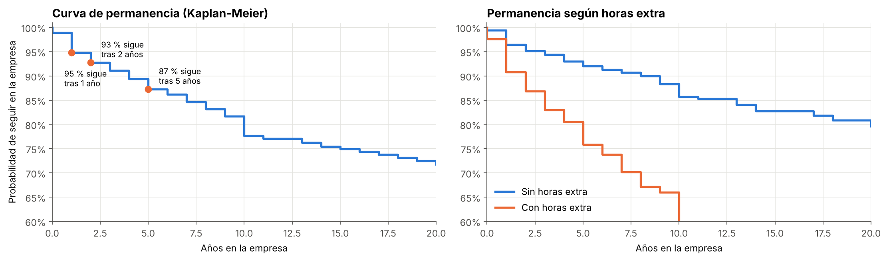
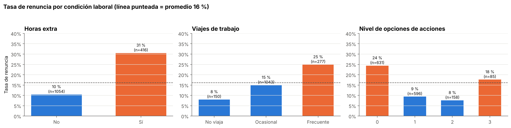
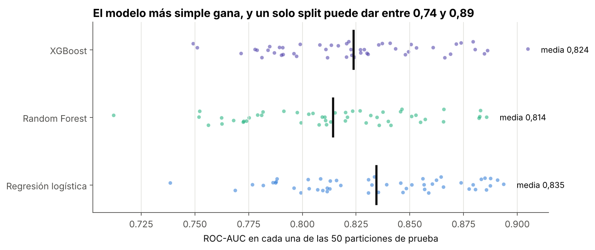
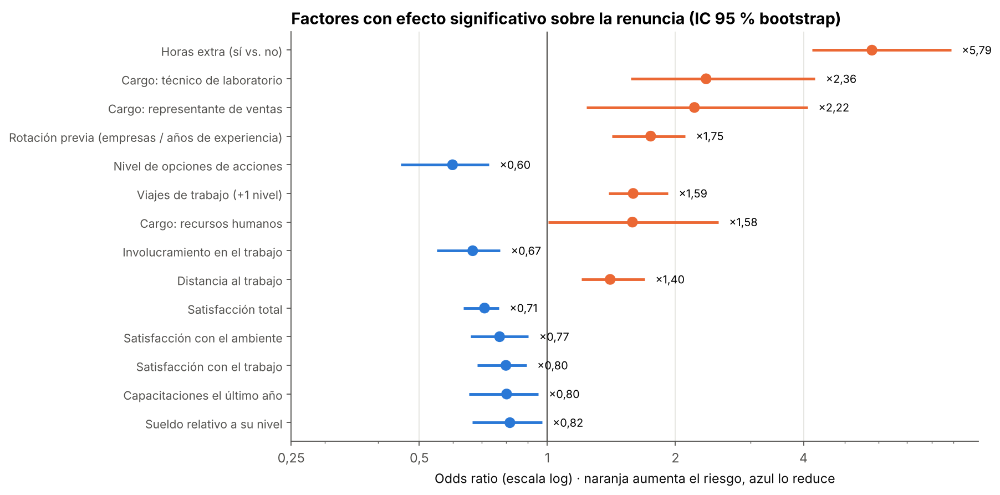
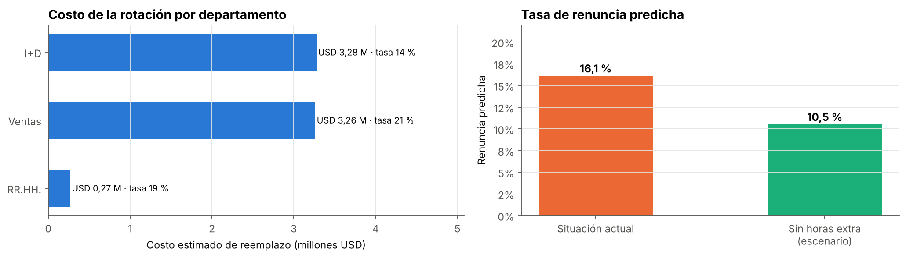
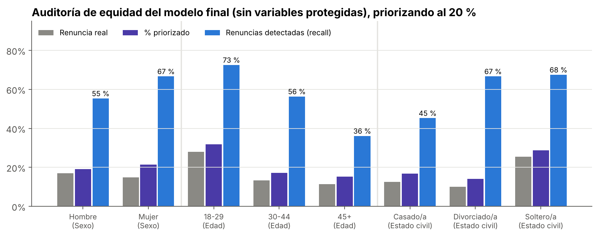
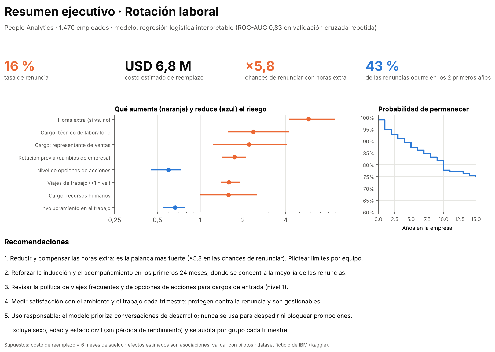

# 👥 People Analytics: ¿por qué renuncian los empleados y qué puede hacer RR.HH.?

> **Cuando el modelo más simple gana.** Una regresión logística interpretable supera a Random Forest y XGBoost en validación cruzada repetida, explica la renuncia con odds ratios que entiende un comité y se convierte en un **resumen ejecutivo de una página** para la gerencia.




---

## 🎯 Problema de negocio

Una empresa de 1.470 personas pierde **16 de cada 100 empleados**. Recursos Humanos pregunta:
1. **¿Qué factores explican la renuncia?** Necesitan respuestas que un comité pueda entender.
2. **¿Cuáles puede cambiar la empresa?** "Los jóvenes solteros renuncian más" no le sirve a RR.HH.
3. **¿A quién priorizar** para conversaciones de desarrollo y retención?

**Uso responsable, definido desde el inicio:** el modelo **nunca** se usa para despedir, bloquear promociones ni decidir contrataciones. Prioriza conversaciones de apoyo y detecta condiciones de trabajo que empujan a renunciar. Los puntajes individuales son confidenciales.

## 📊 Resultados principales

| Indicador | Resultado |
|---|---|
| Mejor modelo (validación cruzada 5×10) | **Regresión logística · ROC-AUC 0,835** (XGBoost 0,824 · Random Forest 0,814) |
| Variación de un solo split | **0,74 a 0,89** de ROC-AUC para el mismo modelo |
| Horas extra | multiplican las chances de renunciar **×5,8** (IC 95 %: 4,2 a 8,9) |
| Renuncias en los primeros 2 años | **43 %** del total |
| Costo estimado de la rotación | **USD 6,8 millones** (supuesto: 6 meses de sueldo por reemplazo) |
| Quitar sexo, edad y estado civil | ROC-AUC 0,825 → 0,819: **no hacen falta** |

## 🕵️ Auditoría: variables que no son lo que parecen

- `EmployeeCount`, `Over18` y `StandardHours` son **constantes**.
- `DailyRate`, `HourlyRate` y `MonthlyRate` parecen remuneraciones, pero **no se relacionan con el sueldo** (correlación de Spearman entre −0,02 y 0,05), mientras que `MonthlyIncome` sí sigue al nivel del cargo (0,92). En este dataset ficticio son ruido, y usarlas como "sueldo" llevaría a conclusiones falsas.

## ⏳ Cuándo se va la gente: curva de permanencia



Curva de **Kaplan-Meier** calculada a mano con `numpy`. El riesgo se concentra en los **primeros años**, y la brecha entre quienes hacen horas extra y quienes no aparece desde el primer año.



## 🎲 Con pocos datos, un solo split puede engañar

Con 1.470 filas y 237 renuncias, se usó **validación cruzada estratificada 5×10** (50 evaluaciones):



| Modelo | ROC-AUC medio | Desv. estándar | Mínimo | Máximo |
|---|---|---|---|---|
| **Regresión logística** ⭐ | **0,835** | 0,038 | 0,739 | 0,894 |
| XGBoost | 0,824 | 0,036 | 0,749 | 0,905 |
| Random Forest | 0,814 | 0,039 | 0,712 | 0,886 |

La logística supera al Random Forest en el 80 % de las particiones. Con pocos datos y relaciones mayormente monótonas, los modelos complejos no tienen de dónde sacar ventaja.

## 📐 Interpretación: odds ratios con intervalos de confianza

Supuestos verificados: la **multicolinealidad** (VIF de 29 entre sueldo y nivel del cargo) se resolvió depurando variables redundantes (VIF máximo final: 1,6). Los intervalos de 95 % se calcularon con **bootstrap** (300 remuestreos):



- **Horas extra ×5,8**: el factor más fuerte y **controlable**.
- **Viajes, distancia, rotación previa** y ciertos cargos (técnicos de laboratorio, representantes de ventas) aumentan el riesgo.
- **Satisfacción, involucramiento, opciones de acciones, capacitación y sueldo relativo al nivel** lo reducen.
- El 60 % del peso del modelo está en **palancas de gestión**, no en características de la persona.

## 💰 Costo y escenario



En un escenario sin horas extra, la tasa de renuncia predicha bajaría de 16,1 % a 10,5 %. *Es una asociación, no un efecto causal: debe validarse con pilotos.*

## ⚖️ Auditoría de equidad



El modelo final **excluye sexo, edad y estado civil**. Aun así prioriza más a jóvenes y solteros, porque su riesgo real es mayor, lo que es aceptable dado el uso de apoyo. Hay **dos brechas a monitorear**: detecta el 67 % de las renuncias de mujeres vs. 55 % de hombres, y solo el 36 % en mayores de 45 años. Por eso se recomienda complementar el modelo con **entrevistas de permanencia** para todos los grupos.

## 📋 Resumen ejecutivo de una página

El entregable para la gerencia, generado directamente desde el notebook (también en [`reports/resumen_ejecutivo.pdf`](reports/resumen_ejecutivo.pdf)):



## 🗂️ Estructura del repositorio

```
hr-attrition-people-analytics/
├── data/                         # Dataset (opcional, ver data/README.md)
├── images/                       # Gráficos y resumen ejecutivo
├── notebooks/
│   └── analisis_rotacion_people_analytics.ipynb
├── reports/
│   ├── resumen_ejecutivo.pdf
│   ├── comparacion_modelos_cv.csv
│   ├── odds_ratios.csv
│   ├── costo_por_departamento.csv
│   └── auditoria_equidad.csv
├── requirements.txt
├── LICENSE
└── README.md
```

## ▶️ Cómo reproducirlo

```bash
git clone https://github.com/Cristobal-111/hr-attrition-people-analytics.git
cd hr-attrition-people-analytics
pip install -r requirements.txt
jupyter notebook notebooks/analisis_rotacion_people_analytics.ipynb
```

En Google Colab: [](https://colab.research.google.com/github/Cristobal-111/hr-attrition-people-analytics/blob/main/notebooks/analisis_rotacion_people_analytics.ipynb). No hace falta descargar nada: si el CSV no está en `data/`, el notebook lo lee desde la fuente pública de IBM. La ejecución completa toma alrededor de 1-2 minutos.

## ⚠️ Limitaciones

- **Dataset ficticio** creado por científicos de datos de IBM: los patrones son ilustrativos.
- Los efectos son **asociaciones**; el escenario "sin horas extra" no es una predicción causal.
- La curva de permanencia asume que `YearsAtCompany` es la antigüedad al renunciar.
- Siguiente nivel: modelo de Cox para predecir **cuándo** ocurrirá la renuncia.

## 📚 Fuente de datos

[IBM HR Analytics Employee Attrition & Performance — Kaggle](https://www.kaggle.com/datasets/pavansubhasht/ibm-hr-analytics-attrition-dataset) · copia pública en [IBM/employee-attrition-aif360](https://github.com/IBM/employee-attrition-aif360).

## 🔗 Serie de proyectos

1. 📉 [Fuga de clientes en telecomunicaciones · Árbol de decisión](https://github.com/Cristobal-111/churn-prediction-telco)
2. 🏨 [Cancelaciones hoteleras · Random Forest](https://github.com/Cristobal-111/hotel-cancellation-random-forest)
3. 💳 [Riesgo de crédito · XGBoost](https://github.com/Cristobal-111/credit-risk-xgboost)
4. 🏥 [Inasistencia a citas médicas · Proyecto integral PACE](https://github.com/Cristobal-111/medical-no-show-pace)
5. 👥 **People Analytics: rotación laboral · Regresión logística interpretable** (este repositorio)

## 👤 Autor

**Cristobal Rojas** · Analista de Datos
[LinkedIn](https://www.linkedin.com/in/cristobal-rojas-troncoso/) · [GitHub](https://github.com/Cristobal-111)
